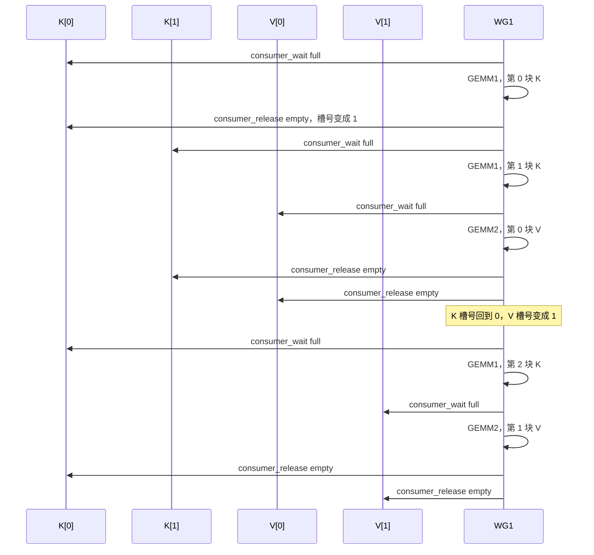
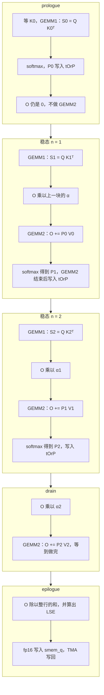
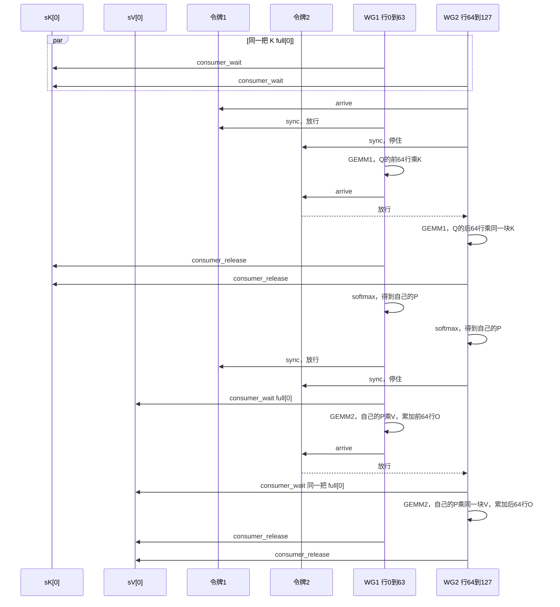

# Stage 8：Hopper FlashAttention 前向的实现与流水线衔接

## 0. 概要

本目录实现 FlashAttention 的前向计算。对每个 batch、每个 head：

\[
S = \mathrm{scale}\cdot QK^\top,\qquad
O = \mathrm{softmax}(S)\,V,\qquad
\mathrm{LSE}_i = \log\textstyle\sum_j e^{S_{ij}}
\]

- 输入 Q、K、V 为 fp16；矩阵乘的累加和 softmax 的中间量为 fp32；输出 O 为 fp16，LSE 为 fp32（可选输出）。
- 支持 head_dim = 64 或 128；支持可选的 causal mask（对角线按右下角对齐）；序列长度可以不是 128 的倍数。
- 只用 CuTe 和 CUTLASS 的同步原语（`PipelineTmaAsync`、mbarrier、`NamedBarrier`）手写，没有使用 CUTLASS 现成的 GEMM 模板。
- 只能运行在 Hopper（`sm_90a`）上。在 V100 或没有 GPU 的机器上可以编译、可以通过机器码检查，正确性测试会跳过（SKIP）。

本文回答三个问题：

1. 一个线程块内部怎样分工，Prologue、Mainloop、Epilogue 各做什么，数据在各阶段之间怎样交接（第 3、4 节）；
2. Mainloop 内部，前一个块的 epilogue 部分（GEMM2）怎样与后一个块的 prologue 部分（GEMM1、softmax）同时进行（第 5 节）；
3. 相邻两个 Q tile 之间，前一个 tile 的 Epilogue 与后一个 tile 的 Prologue 是否同时进行（第 6 节）。结论是目前没有，第 6 节说明原因和改法。

---

## 1. 术语

本文反复使用下列词语，这里先给出含义。

| 术语 | 含义 |
| --- | --- |
| CTA（线程块） | 一次 kernel 启动中的一个线程块。本 kernel 每个 CTA 有 384 个线程 |
| warpgroup | 连续 4 个 warp，共 128 个线程。Hopper 的矩阵乘指令以 warpgroup 为单位执行 |
| smem | 共享内存，CTA 内所有线程可见 |
| TMA | Hopper 的数据搬运硬件。一个线程发出一条指令，硬件就把一整块数据在显存和 smem 之间搬运，搬运期间线程可以继续做别的事 |
| WGMMA | Hopper 的矩阵乘指令。发出后立即返回，计算在后台进行；之后用 `warpgroup_wait<N>` 等待完成 |
| `warpgroup_wait<N>` | 等待，直到「已发出但未完成」的 WGMMA 组最多剩 N 组。组按发出顺序完成，所以 `wait<1>` 表示除最后发出的一组外其余都已完成，`wait<0>` 表示全部完成 |
| mbarrier | 存放在 smem 里的计数器式同步对象。到达次数（以及 TMA 写入的字节数）满足预设值后完成一轮，然后自动开始下一轮 |
| phase | mbarrier 当前所处轮次的奇偶位，每完成一轮在 0 和 1 之间切换一次。等待方需要指明自己等的是哪个 phase 的完成 |
| named barrier | 硬件提供的 16 个 CTA 内同步点，可以只让一部分线程参与。`sync` 表示到达并等待，`arrive` 表示只到达不等待 |
| tile | 一个 CTA 负责的 128 行 Q，以及对应的 128 行输出 O |
| 块 | 沿 seq_k 方向每 128 个位置的 K 和 V。一个 tile 要依次处理 N 个块 |
| Prologue / Mainloop / Epilogue（首字母大写） | kernel 级的三个阶段：Prologue 在循环开始前准备数据；Mainloop 循环处理 N 个块；Epilogue 把结果处理后写回显存。与 [`05_qdq_fusion/docs/pipeline_handoff_analysis.md`](../05_qdq_fusion/docs/pipeline_handoff_analysis.md) 的用法一致 |
| 块的 prologue 部分 / epilogue 部分 | 处理一个块的工作分成前后两部分：prologue 部分是 GEMM1 和 softmax（下文也叫 S 段），epilogue 部分是缩放 O 和 GEMM2（下文也叫 O 段）。见第 5.1 节 |
| 流水线 prologue / 稳态循环 / 流水线 epilogue | Mainloop 内部软件流水线的三段（第 5.2 节）。流水线 prologue 只执行块 0 的 prologue 部分；稳态循环每次执行「块 n 的 prologue 部分 + 块 n-1 的 epilogue 部分」；流水线 epilogue 只执行最后一块的 epilogue 部分。加「流水线」前缀是为了和 kernel 级的 Prologue/Epilogue 区分 |
| NVVM / ptxas | CUDA 编译的两个阶段：NVVM 把 C++ 编译成 PTX 中间代码；ptxas 把 PTX 编译成机器码（SASS），并在这一步重新安排指令顺序 |

---

## 2. 文件与调度选项

| 文件 | 内容 |
| --- | --- |
| [`kernels/flash_attn_fwd_sm90.cuh`](kernels/flash_attn_fwd_sm90.cuh) | 对外接口：参数结构 `FlashAttnParams`、调度枚举 `FlashAttnSchedule`、入口函数 `FlashAttnFwdSm90()` |
| [`kernels/flash_attn_fwd_sm90.cu`](kernels/flash_attn_fwd_sm90.cu) | kernel 本体：初始化、按 warpgroup 分工、Epilogue；主机端创建 TMA 描述符并按参数选择模板实例 |
| [`kernels/flash_attn_mainloop_sm90.cuh`](kernels/flash_attn_mainloop_sm90.cuh) | `FusedAttentionMainloop`：smem 布局、数据加载 `load()`、计算 `mma()`（三种调度）、两个 warpgroup 的轮流机制 |
| [`kernels/flash_attn_softmax.cuh`](kernels/flash_attn_softmax.cuh) | online softmax、mask、把 GEMM1 的结果重新解释成 GEMM2 的输入 |
| [`kernels/correctness_test.cu`](kernels/correctness_test.cu) | 用 CPU 双精度算参考结果，比对 O 和 LSE；三种调度都测 |
| [`test/verify_sass_sm90.sh`](test/verify_sass_sm90.sh) | 编译出机器码，检查指令种类、重叠是否真的发生、有无寄存器溢出 |

调度方式由 `FlashAttnParams::schedule` 选择。head_dim（2 种）× 是否 causal（2 种）× 调度（3 种），共编译 12 个 kernel。

| `FlashAttnSchedule` | 含义 |
| --- | --- |
| `kSerial` | 每个块依次执行 GEMM1、softmax、GEMM2，三者不重叠。用作对照 |
| `kIntraWGOverlap` | 同一个 warpgroup 内，块 n-1 的 GEMM2 与块 n 的 softmax 同时进行（第 5.2 节） |
| `kPingPong`（默认） | 在上一种的基础上，两个计算 warpgroup 轮流发出矩阵乘（第 5.4 节） |

---

## 3. 一个 CTA 的分工

### 3.1 线程分工

grid 为 `(ceil(seqlen_q / 128), num_heads, batch)`。**每个 CTA 只计算一个 tile，算完即退出。**

384 个线程分成 3 个 warpgroup：

| warpgroup | 角色 | 每线程寄存器上限 | 工作 |
| --- | --- | --- | --- |
| WG0 | 加载方（producer） | 24 | 128 个线程一起把寄存器上限降到 24；发出 TMA 的只有线程 0 |
| WG1 | 计算方（consumer） | 240 | 负责 tile 的第 0–63 行：GEMM1、softmax、GEMM2，最后执行 Epilogue |
| WG2 | 计算方（consumer） | 240 | 负责第 64–127 行，工作同 WG1 |

表中的 24 和 240 是 `setmaxnreg` 的运行时上限，不是编译器报出来的寄存器数。加载方几乎不需要寄存器，所以把额度让给计算方。24×128 + 240×256 = 168×384；第 6.1 节和第 8 节里的「每线程 168 个寄存器」就是按这个总和折算的，用来判断一个 SM 放不下一个 CTA。

### 3.2 两次矩阵乘

| | 计算 | 形状 (M, N, K) | 左矩阵来自 | 右矩阵来自 |
| --- | --- | --- | --- | --- |
| GEMM1 | \(S = QK^\top\) | (128, 128, D) | smem 中的 Q | smem 中的 K |
| GEMM2 | \(O \mathrel{+}= PV\) | (128, D, 128) | 寄存器中的 P | smem 中的 V |

- 每个计算 warpgroup 负责 M 方向的 64 行。
- GEMM1 的结果在寄存器中的排列方式，恰好就是 GEMM2 左矩阵要求的排列方式。所以 softmax 算出的 P 只需从 fp32 转成 fp16，不必写入 smem（`convert_layout_acc_Aregs`）。
- V 在 smem 中按 `[seq_k, D]` 存放，GEMM2 需要的是它的转置。代码用 `sVt` 以转置的方式索引同一块 smem，没有搬移数据；WGMMA 支持直接读这种排列。

### 3.3 共享内存

D=128 时共约 160 KiB，D=64 时约 80 KiB。

| 缓冲区 | 大小 | 用途 |
| --- | --- | --- |
| `smem_q` | 128 × D | Mainloop 期间存放 Q；Epilogue 时 Q 已不再使用，改为暂存 O |
| `smem_k` | 2 个槽位 × 128 × D | 存放 K。两个槽位轮流使用：计算方读一个槽位时，加载方可以向另一个写 |
| `smem_v` | 2 个槽位 × 128 × D | 存放 V，方式同上 |
| `barrier_q` | 8 字节 | 通知「Q 已到达」的 mbarrier，只使用一次 |

K 和 V 各用一套独立的同步对象，所以 GEMM1 只需等 K 到达，不必等 V。

---

## 4. Prologue、Mainloop、Epilogue：各做什么，怎样交接

### 4.1 总览

```text
               加载方（WG0 的线程 0）                  计算方（WG1、WG2）
               ──────────────────────                  ──────────────────
初始化         warp 0 初始化所有 mbarrier
               ─────────────── __syncthreads() ───────────────     ← 交接 0
Prologue       TMA 加载 Q，完成时通知 barrier_q        等待 barrier_q
Mainloop       先发出 K0、V0、K1、V1（槽位一开始是空的）
               之后逐块：等槽位空 → TMA 加载下一块      串行时逐块：等 K → GEMM1 → 释放 K
                                                              等 V → GEMM2 → 释放 V
                      「槽位已空」与「数据已到」两种 mbarrier 来回通知     ← 交接 1
               producer_tail：等两个槽都被释放         默认调度会把上面几步重叠，见第 5 节
Epilogue                                               O 除以行和，算 LSE             ← 交接 2
                                                       O 写入 smem_q，同步
                                                       WG1 的第一个线程用 TMA 写回 O  ← 交接 3
                                                       LSE 由各线程直接写回显存
```

### 4.2 三个阶段各做什么

下表按时间顺序列出每个阶段中两种角色的工作，以及这个阶段结束时交给下一阶段的数据。代码入口：Prologue 和 Epilogue 在 [`flash_attn_fwd_sm90.cu`](kernels/flash_attn_fwd_sm90.cu) 的 kernel 函数里；Mainloop 是 [`flash_attn_mainloop_sm90.cuh`](kernels/flash_attn_mainloop_sm90.cuh) 的 `load()`（加载方）和 `mma()`（计算方）。

| 阶段 | 加载方（WG0 的线程 0） | 计算方（WG1、WG2，每个负责 64 行） | 结束时交出 |
| --- | --- | --- | --- |
| **Prologue** | 1. 预取 TMA 描述符；warp 0 初始化所有 mbarrier<br>2. 全 CTA `__syncthreads()`<br>3. 把寄存器上限降到 24<br>4. 告诉 `barrier_q` 将写入多少字节，发出 Q 的 TMA | 1. 同左第 2 步<br>2. 把寄存器上限升到 240<br>3. 累加器 `tOrO` 清零；每行 `row_max = -∞`、`row_sum = 0`<br>4. 等待 `barrier_q`，即等 Q 到达 smem | smem 中的 Q；寄存器中清零的 O 和 softmax 状态 |
| **Mainloop** | 对 n = 0, …, N-1：等 K 槽位空 → 发出 K(n) 的 TMA；等 V 槽位空 → 发出 V(n) 的 TMA。前两次两个槽位都空，不用等待，相当于预取。循环结束后用 `producer_tail` 等所有槽位被释放 | 下面 1–5 是串行调度里一个块的顺序。默认的 `kPingPong` 不按这个顺序执行，只保证算完的内容相同（第 5 节）：<br>1. 等 K(n) 到达 → GEMM1：\(S = QK(n)^\top\) → 释放 K 槽位<br>2. 需要时做 mask<br>3. online softmax：更新 `row_max`、`row_sum`，把 S 原地变成 P，得到缩放系数 α<br>4. O 乘 α<br>5. 等 V(n) 到达 → GEMM2：\(O \mathrel{+}= PV(n)\) → 释放 V 槽位 | 寄存器中的 `tOrO`（尚未除以行和）、`row_max`、`row_sum` |
| **Epilogue** | 无工作。`producer_tail` 在 Mainloop 末尾已经返回 | 1. 在寄存器中完成全部计算：行和规约、O 乘 1/行和、算 LSE（`finalize`）<br>2. 在寄存器中把 O 从 fp32 转成 fp16<br>3. 把 fp16 的 O 写入 smem_q，两次同步（第 4.6 节）<br>4. WG1 的第一个线程（`threadIdx.x == 128`）用 TMA 把 O 写回显存，并等待 TMA 读完 smem<br>5. LSE 直接从寄存器写回显存 | 显存中的 O 和 LSE |

#### Epilogue 的计算在累加器寄存器上完成

用 GEMM epilogue 的通用形式 \(D = \alpha \cdot \mathrm{acc} + \beta \cdot C\) 来对照：

- acc 是 Mainloop 留在寄存器中的累加器 `tOrO`；
- α 不是标量，而是每行一个值：\(\alpha_i = 1/\ell_i\)，\(\ell_i\) 是第 i 行的指数和；
- 没有 C，相当于 β = 0；
- 另外还要算出每行的 \(\mathrm{LSE}_i = m_i \cdot \mathrm{scale} + \log \ell_i\)。

这些计算都由 `OnlineSoftmax::finalize` 直接在 `tOrO` 上完成。每个线程持有的 O 元素和它们所在行的 \(\ell_i\)、\(m_i\) 在同一个线程（或相邻 4 个线程）的寄存器里，只需一次 `shfl_xor` 规约得到整行的和，不需要先把累加器搬到 smem 换排列。之后 `convert_type` 在寄存器中转成 fp16。

smem 只在计算全部结束后使用：作为 TMA 写回的暂存区。线程只向 smem 写，不会再从 smem 读回数据做计算。

机器码可以验证这一点：

- 12 个 kernel 中没有任何 smem 读取指令（`LDS`/`LDSM`），第 8 节的检查脚本会确认这一点；
- Epilogue 段的指令顺序是：`SHFL.BFLY`（行和规约）→ `MUFU.RCP`（求倒数）→ `FMUL`（乘到累加器上）→ `F2FP`（转 fp16）→ 写 smem → `BAR.SYNC` → `UTMASTG`（TMA 写回）。

### 4.3 交接 0：初始化 → 所有线程

warp 0 中的一个线程初始化 `barrier_q`；两个 `PipelineTmaAsync` 对象在构造时初始化各自的 mbarrier。随后执行 `__syncthreads()`，保证所有线程在使用 mbarrier 之前都能看到初始化结果。

这是整个 kernel 中唯一一次全 CTA 同步。此后加载方和计算方只通过 mbarrier 与 named barrier 通信。

### 4.4 交接 1：加载方 → 计算方（经由 smem）

**Q 只加载一次。** 加载方先告诉 `barrier_q` 「将有 `kTmaBytesQ` 字节写入」（`arrive_and_expect_tx`），再发出 TMA。字节全部写入后，`barrier_q` 完成第一轮。计算方用 `wait(&barrier_q, 0)` 等待这一轮完成。

**K 和 V 各使用两个槽位。** 每个槽位配两个 mbarrier：

| mbarrier | 含义 | 由谁通知 | 由谁等待 |
| --- | --- | --- | --- |
| full[s] | 槽位 s 的数据已到达 | 加载方声明字节数；TMA 写完时硬件自动完成 | 计算方（`consumer_wait`） |
| empty[s] | 槽位 s 已读完，可以覆盖 | 两个计算 warpgroup 各通知一次（`consumer_release`） | 加载方（`producer_acquire`） |

双方各用一个 `PipelineState` 记录「当前槽位编号」和「当前等待的 phase」。每处理完一块就前进一个槽位，从最后一个槽位回到第一个时 phase 切换。

**开头两块不需要等待。** 加载方的初始状态（`make_producer_start_state`）把要等待的 phase 设为 1，而 empty[s] 初始时处于 phase 0。因此加载方前两次 `producer_acquire` 立即返回，K0、V0、K1、V1 一开始就连续发出。从第三块开始，加载方必须等计算方释放槽位。

**释放越早，下一次加载越早开始。** K(n) 在 GEMM1(n) 完成后立即释放，V(n) 在 GEMM2(n) 完成后释放。槽位释放后，加载方即可向其中写入 K(n+2) 或 V(n+2)。

WG1 和 WG2 各有一份 `smem_pipe_read_k`、`smem_pipe_read_v`，初值都是槽 0，所以两边 `consumer_wait` 等的是同一把 `full`。下图只画 WG1，用来看槽号怎么走；WG2 对同一把 barrier 做同样的等待和释放。流水线 prologue 只推进 K 的槽号，所以进入稳态后，正在读的 K 比 V 超前一块：



### 4.5 交接 2：Mainloop → Epilogue（经由寄存器）

Mainloop 结束时，每个计算线程的寄存器中有：

- `tOrO`：尚未除以行和的输出 \(\sum_j e^{S_{ij}-m_i} V_j\)，fp32。D=128 时每线程 64 个值。
- `row_max`、`row_sum`：该线程负责的 2 行的当前最大值，以及该线程自己那部分元素的指数和。同一行的元素分布在相邻 4 个线程上，所以 `row_sum` 还不是整行的和。

Epilogue 中的 `finalize`：

1. 在相邻 4 个线程之间做一次规约（`shfl_xor`），得到整行的指数和；
2. 若整行都被 mask（只在 causal 且 seqlen_q > seqlen_k 时出现），行和为 0：令 O = 0，LSE = +∞；
3. 否则：O 乘以 1/行和；LSE = row_max × scale + log(行和)。

采用重叠调度时，稳态循环的最后一次结束后，最后一块的 epilogue 部分（GEMM2）还没有执行，要在流水线 epilogue 中执行（第 5.2 节）。因此 O 在流水线 epilogue 完成后才是最终值：交接 2 发生在流水线 epilogue 之后，kernel 级的 Epilogue 必须等它结束才能开始。

### 4.6 交接 3：Epilogue → 显存

O 用 TMA 一次写回，TMA 要求数据先在 smem 中排好。本 kernel 不单独分配 O 的缓冲区，而是复用 `smem_q`。顺序如下：

1. **`NamedBarrier::sync(256, kBarrierEpilogue)`**：两个计算 warpgroup 都执行完最后一次 GEMM1 后，才开始写 smem_q。
   每个 warpgroup 只覆盖自己 GEMM1 读过的 64 行，严格说各自等自己的 GEMM1 完成就够了；代码在这里同步全部 256 个线程，是一种保守做法。
2. 每个线程把自己的 O（已转成 fp16）写入 smem_q。
3. **`tma_store_fence()`**：普通线程写入 smem 的数据，TMA 硬件不一定立即能看到。这条 fence 保证 TMA 读取时能看到刚才的写入。
4. **再一次 `NamedBarrier::sync`**：确认 256 个线程都已写完。
5. WG1 的第一个线程发出 TMA 写回（`UTMASTG`），然后用 `tma_store_arrive` / `tma_store_wait<0>` 等待 TMA 读完 smem，之后 CTA 才能退出。这不是加载方的线程 0。

超出 seqlen_q 的行不会被 TMA 写回显存。

LSE 每行只有一个 float，数据量很小，不使用 TMA：每行由持有该行的 4 个线程中的第一个（`lane % 4 == 0`）直接写回，超出 seqlen_q 的行跳过。

**此时加载方的状态：** 加载方发出最后一块的 K、V 后调用 `producer_tail`，等待所有槽位都被计算方释放，然后结束。在 Epilogue 期间加载方没有任务。

---

## 5. Mainloop 内部：前一块的 epilogue 部分与后一块的 prologue 部分同时进行

### 5.1 把一个块的工作分成 prologue 部分和 epilogue 部分

| 部分 | 内容 | 依赖 |
| --- | --- | --- |
| prologue 部分（S 段） | GEMM1：\(S(n) = QK(n)^\top\)；mask；online softmax，得到 P(n) 和缩放系数 \(\alpha(n) = e^{m(n-1)-m(n)}\) | Q、K(n)、上一块的行最大值 |
| epilogue 部分（O 段） | O 乘以 \(\alpha(n)\)；GEMM2：\(O \mathrel{+}= P(n)V(n)\) | 本块 prologue 部分的结果、V(n) |

块 n+1 的 prologue 部分不需要块 n 的 epilogue 部分的任何结果：它只需要块 n 的行最大值，而行最大值在块 n 的 prologue 部分就已经得到。所以块 n 的 epilogue 部分可以与块 n+1 的 prologue 部分同时进行。两者使用的硬件也不同：GEMM2 使用矩阵乘单元，softmax 使用指数运算单元和普通浮点单元。

这就是软件流水线的基本做法：每次循环执行「本块的 prologue 部分 + 上一块的 epilogue 部分」。循环开始前要单独执行一次块 0 的 prologue 部分（流水线 prologue），循环结束后要单独执行一次最后一块的 epilogue 部分（流水线 epilogue）。

### 5.2 串行与重叠两种写法

**串行（`kSerial`）：**

```text
每个块：GEMM1 → 等待 → mask + softmax → O 乘 α → GEMM2 → 等待 → 下一块
        矩阵乘单元工作    指数单元工作              矩阵乘单元工作
```

每次等待时，warpgroup 什么也不做。softmax 每块每线程要算 66 次指数（64 个元素加 2 个缩放系数）；这段时间矩阵乘单元空闲，反过来 GEMM 期间指数单元空闲。

**重叠（`kIntraWGOverlap`）：** 稳态循环的第 n 次（n = 1, …, N-1）同时处理块 n 的 prologue 部分和块 n-1 的 epilogue 部分。

| 阶段 | 发出的矩阵乘 | 在 `wait<1>` 与 `wait<0>` 之间做的事 | 在 `wait<0>` 之后做的事 |
| --- | --- | --- | --- |
| 流水线 prologue | GEMM1(0) | 无（直接 `wait<0>`，然后 softmax(0)） | 把 P(0) 转成 fp16 |
| 稳态循环第 n 次 | GEMM1(n)；O 乘 α(n-1)；GEMM2(n-1) | mask 与 softmax(n)，此时 GEMM2(n-1) 仍在执行 | 释放 V 槽位；把 P(n) 转成 fp16 |
| 流水线 epilogue | O 乘 α(N-1)；GEMM2(N-1) | 无 | 释放 V 槽位 |
| kernel 级 Epilogue | | | `finalize`（交接 2） |

流水线 prologue 只有 prologue 部分（前面没有块需要做 epilogue 部分），流水线 epilogue 只有 epilogue 部分（后面没有块需要做 prologue 部分）。N 个块共执行 N+1 段，中间的 N-1 次稳态循环有重叠。N = 1 时没有稳态循环，等同于串行。

以三块为例，计算方依次经过流水线 prologue、两次稳态循环、流水线 epilogue（图中的 drain），然后才进入 kernel 级 Epilogue：



对应代码（`mma()` 中的 `steady_state_iteration`，省略了 fence）：

```cpp
pipeline_k.consumer_wait(k);
wgmma_gemm<true, -1>(qk, tSrQ, tSrK(k), tSrS);     // 发出 GEMM1(n)，不等待
Softmax::rescale_o(tOrO, scale_o);                  // O 乘 α(n-1)；GEMM2 还没发出，可以修改 O
pipeline_v.consumer_wait(v);
wgmma_gemm<false, -1>(pv, tOrP, tOrV(v), tOrO);     // 发出 GEMM2(n-1)，不等待
warpgroup_wait<1>();                                // GEMM1(n) 已完成，GEMM2(n-1) 可能未完成
pipeline_k.consumer_release(k);
if constexpr (kMask) apply_mask(...);              // 只有需要 mask 的块才编译这一行
softmax.online_softmax(tSrS, scale_o);              // 与 GEMM2(n-1) 同时执行
__syncwarp();                                       // 防止 ptxas 把下一行提前，见第 7 节
warpgroup_wait<0>();                                // GEMM2(n-1) 已完成
pipeline_v.consumer_release(v);
convert_into(tSrS, tOrP);                           // 用 P(n) 覆盖 P(n-1)
```

### 5.3 重叠必须满足的条件

| 条件 | 原因 | 代码中的位置 |
| --- | --- | --- |
| O 的缩放推迟到下一次循环 | softmax(n) 算出 α(n) 时，GEMM2(n-1) 正在向 O 累加，此时不能修改 O | `rescale_o` 放在下一次 GEMM2 发出之前；最后一次放在流水线 epilogue |
| softmax 前用 `wait<1>`，不用 `wait<0>` | `wait<1>` 只保证 GEMM1(n) 完成，允许 GEMM2(n-1) 继续执行 | softmax 位于 `wait<1>` 与 `wait<0>` 之间 |
| P(n) 的写入放在 `wait<0>` 之后 | GEMM2(n-1) 执行期间一直在读 `tOrP` 中的 P(n-1) | `convert_into` 位于 `wait<0>` 之后 |
| K 槽位在 `wait<1>` 后立即释放 | 此后没有指令再读 K(n) | 加载方可以更早写入下一块 K |
| 两次 wait 之间不能有运行时分支 | 在分支汇合处，ptxas 会插入「等待所有矩阵乘完成」的指令，重叠随之消失 | 是否需要 mask 改为编译期常量，把循环拆成两段：前段处理不需要 mask 的块，后段处理需要 mask 的块（这些块总在末尾）。分界由 `first_masked_block` 计算 |

### 5.4 两个 warpgroup 轮流发出矩阵乘（`kPingPong`）

第 5.2 节让每个 warpgroup 的矩阵乘与它自己的 softmax 重叠。这一节再让两个 warpgroup 错开：WG1 发出矩阵乘时 WG2 在做 softmax，反过来也一样。这样两个 warpgroup 的矩阵乘不会同时排队等待矩阵乘单元。

实现用两个 named barrier：`kBarrierTurnWG1` 和 `kBarrierTurnWG2`，每个都要求 256 个线程到达才能通过。轮到某个 warpgroup 时，它的 128 个线程在自己的 barrier 上 `sync`；另一个 warpgroup 的 128 个线程在同一个 barrier 上 `arrive`。两边都到达后，前者继续执行。

```text
开始时：  WG2 在 TurnWG1 上 arrive            → WG1 先发出矩阵乘
每一轮：  在自己的 barrier 上 sync           （等待轮到自己）
          发出 GEMM1，O 乘 α，发出 GEMM2
          在对方的 barrier 上 arrive         （轮到对方）
          wait<1> → softmax → wait<0>        （此时对方在发出矩阵乘）
```

WG2 也做 GEMM1 和 GEMM2。128 行的 Q 被拆成两半：WG1 算行 0–63，WG2 算行 64–127。两边读同一块 K、同一块 V，各自得到自己那 64 行的 S、P 和 O。令牌只决定谁先发指令。



图的上半段是流水线 prologue：两边都做第 0 块的 GEMM1 和 softmax，此时还没有 GEMM2。空行之后是下一轮：WG1 先用第 0 块的 P 和 V 做 GEMM2，再把令牌交给 WG2 做同样的 GEMM2。

每个 warpgroup 恰好轮到 N 次：流水线 prologue 1 次，稳态循环 N-1 次；流水线 epilogue 不参与轮流。WG2 在最后一轮不执行 arrive。否则 TurnWG1 上会多出一次到达，而 WG1 不会再来 sync，CTA 退出时这个 barrier 会停在未完成的状态。

轮流机制只改变两个 warpgroup 发出矩阵乘的先后顺序，与 Prologue/Epilogue 的衔接无关。它的前提是第 5.2 节已经把「发出矩阵乘」和「执行 softmax」分开了。

---

## 6. 相邻两个 tile 之间：前一个 Epilogue 与后一个 Prologue

### 6.1 现状：两者不会同时进行

本 kernel 每个 CTA 只计算一个 tile，计算完就退出；下一个 tile 由另一个 CTA 计算。并且一个 SM 上同一时刻只能运行一个本 kernel 的 CTA：

- 寄存器：按第 3.1 节的分配，24×128 + 240×256 = 168×384 = 64512，而一个 SM 共有 65536 个，放不下第二个 CTA；
- smem：D=128 时每个 CTA 约 160 KiB，单个 CTA 的上限是 227 KiB。

因此在同一个 SM 上，执行顺序如下：

```text
CTA i  ：…稳态循环 → 流水线 epilogue → finalize → O 写入 smem → TMA 写回 → 等待写回读完 smem → 退出
CTA i+1：                                                                          启动 → 初始化 mbarrier → __syncthreads
                                                                                   → TMA 加载 Q、K0、V0 → 等待数据到达 → GEMM1(0) …
```

从 CTA i 退出到 CTA i+1 开始第一次矩阵乘，中间这段时间该 SM 不做任何矩阵乘。这段时间包括：

1. 启动新 CTA；
2. 初始化 mbarrier、预取 TMA 描述符；
3. 从显存读取 Q、K0、V0 的完整延迟。

CTA i 的 Epilogue 期间，加载方已经没有任务（第 4.6 节），但它不能提前为下一个 tile 加载数据，因为下一个 tile 不归这个 CTA 计算。

tile 数远多于 SM 数时（长序列、多 head），每个 tile 都要付一次这段等待时间。每个 tile 的块数 N 越少（seq_k 较短，或 causal 时靠前的 tile），这段时间占总时间的比例越高。

### 6.2 改法：让一个 CTA 连续计算多个 tile（未实现）

CUTLASS 的 Hopper GEMM 和 FlashAttention-3 采用这种做法，通常称为「持久 kernel」：

- grid 只启动与 SM 数量相同的 CTA；
- 每个 CTA 循环领取下一个 `(m_block, head, batch)`，直到全部算完；
- 加载方发出当前 tile 最后一块的 K、V 之后，不等计算方，立即开始加载下一个 tile 的 Q、K、V。

```text
加载方：…K(N-1)、V(N-1) │ 下一个 tile 的 Q、K0、V0、K1、V1 …
计算方：…GEMM(N-1)  流水线 epilogue  Epilogue（写 O、LSE） │ 下一个 tile 的 GEMM1(0) …
                            ↑ 计算方做 Epilogue 时，加载方已经在加载下一个 tile
```

现有代码有几处依赖「一个 CTA 只计算一个 tile」，改成持久 kernel 时必须修改：

| 现有做法 | 为什么在持久 kernel 中不成立 | 修改方法 |
| --- | --- | --- |
| O 暂存在 `smem_q` 中 | 加载方要向 smem_q 写下一个 tile 的 Q，而此时 TMA 可能还在从这里读当前 tile 的 O | 二选一：(a) 为 O 单独分配 smem，D=128 时多 32 KiB，总量约 192 KiB，仍低于 227 KiB；(b) 增加一个从计算方到加载方的通知：计算方在 `tma_store_wait` 之后通知「smem_q 可以覆盖」，加载方收到后才发出下一个 Q 的 TMA |
| `barrier_q` 只等待 phase 0 | 每个 tile 都要使用一次 `barrier_q` | 等待的 phase 随 tile 序号交替：`wait(&barrier_q, tile_iter & 1)` |
| K/V 的 `PipelineState` 在 kernel 开始时创建一次，用完即止 | 多个 tile 共用同一组槽位和 mbarrier，mbarrier 的轮次在 tile 之间是连续的 | `PipelineState` 跨 tile 继续前进，不能重新初始化；`producer_tail` 只在全部 tile 结束后调用一次 |
| 写 O 到 smem 之前不检查 | 若采用方案 (a)，上一个 tile 的 TMA 写回可能还在读 O 的缓冲区 | 写 O 之前先 `tma_store_wait<0>()`，等上一个 tile 的写回读完 smem |
| `tOrO` 和 softmax 状态只在 kernel 开始时初始化 | 每个 tile 都要从零开始累加 | 每个 tile 开始时 `clear(tOrO)`，并重置 `row_max`、`row_sum` |

下面几项不需要修改：

- **K/V 槽位本身。** 当前 tile 的流水线 epilogue 释放最后一个 V 槽位，最后一次稳态循环释放最后一个 K 槽位。只要 `PipelineState` 跨 tile 连续，加载方为下一个 tile 调用 `producer_acquire` 时，会按正确的 phase 等待这些槽位被释放。也就是说，K/V 在 tile 之间的衔接由已有的同步对象自动完成；需要手工处理的只有不在槽位中的两块 smem：Q 和 O。
- **两个 warpgroup 的轮流机制。** 现在的写法在每个 tile 内开始和结束时都是平衡的（第 5.4 节），可以直接用于多个 tile。
- **寄存器分配。** 持久 kernel 仍然是每个 SM 一个 CTA，寄存器上限不变。

这也与 05 文档的结论一致：Hopper 持久 GEMM 不能像 V100 那样让 Mainloop 和 Epilogue 共用同一块 smem，因为两者的使用时间重叠。本 kernel 能把 O 放进 smem_q，正是因为它不是持久 kernel。

### 6.3 两个层次的对比

| | 块与块之间（Mainloop 内部，已实现） | tile 与 tile 之间（未实现） |
| --- | --- | --- |
| 前一个 epilogue | 块 n-1 的 epilogue 部分：O 乘 α，GEMM2 | tile i 的 Epilogue：除以行和、写回 O 和 LSE |
| 后一个 prologue | 块 n 的 prologue 部分：GEMM1，softmax | tile i+1 的 Prologue：用 TMA 加载 Q、K0、V0 |
| 同时工作的硬件 | 矩阵乘单元（GEMM2）与指数、浮点单元（softmax） | TMA 与显存（加载下一个 tile）与计算 warpgroup（Epilogue） |
| 两段之间传递数据的位置 | 寄存器：O、P、推迟一轮的 α | smem：Q 缓冲区、O 暂存区、K/V 槽位 |
| 同步方式 | `warpgroup_wait<1>` 与 `warpgroup_wait<0>` | mbarrier 的轮次跨 tile 连续，加上 Q/O 缓冲区的「可以覆盖」通知 |
| 无法重叠的部分 | 流水线 prologue（只有块 0 的 prologue 部分）、流水线 epilogue（只有最后一块的 epilogue 部分） | 第一个 tile 开始时没有可提前加载的数据；最后一个 tile 结束时的 `producer_tail` |

---

## 7. 编译器问题：源码写了重叠，机器码里不一定有

WGMMA 发出后在后台执行，ptxas 在安排指令顺序时会考虑这一点，但它不保证保留源码中的重叠。下面的问题都在开发中实际出现过。它们的共同表现是：编译通过，结果正确，但重叠消失了。

| 现象 | 原因 | 处理 |
| --- | --- | --- |
| ptxas 提示 C7504（`setmaxnreg` 被忽略）和 C7509（WGMMA 被串行化） | 工程开启了可分离编译（`CUDA_SEPARABLE_COMPILATION`，即 `-rdc`） | 本目录的库单独关闭（见 [`CMakeLists.txt`](CMakeLists.txt)） |
| softmax 被移到 `wait<0>` 之后 | 只操作寄存器的计算，编译器可以随意移到等待指令之后 | 在 softmax 结束处加寄存器 fence（`fence_registers`、`warpgroup_fence_operand`）。它们只约束 NVVM，不约束 ptxas |
| 运行时分支后面多出 `WARPGROUP.DEPBAR.LE gsb0, 0x0`（等待所有矩阵乘完成） | 两次 wait 之间有「是否需要 mask」的运行时判断，ptxas 在分支汇合处等待全部矩阵乘完成 | 改为编译期常量，循环拆成两段 |
| 轮流调度的 kernel 占用了全部 16 个 named barrier | barrier 编号在运行时才确定，ptxas 只能把 16 个都预留 | 在每个分支里写常量编号，占用降到 9 个 |
| head_dim=64、需要 mask 的那段循环中，指数运算被移到 `wait<0>` 之后 | ptxas 把 `wait<0>` 提前到 softmax 之前；NVVM 层的 fence 对此无效 | 在 `wait<0>` 前加 `__syncwarp()`。用当前的 nvcc 12.9 编译，加上之后 ptxas 不再把 `wait<0>` 提前 |
| 尝试过：P 用两组寄存器交替，经寄存器拷贝切换 | ptxas 把两组寄存器合并成一组，导致 GEMM2 执行期间 P 被改写；ptxas 提示 C7513 并把 WGMMA 串行化 | 已放弃 |
| 尝试过：P 用两组寄存器交替，循环展开两次 | 循环体中的 lambda 不再内联，出现栈和约 1.9 万条本地内存读写（LDL/STL） | 已放弃 |

`__syncwarp()` 的效果依赖 ptxas 当前的行为，不是语言层面的保证，换 nvcc 版本后可能失效。第 8 节的机器码检查用来发现这种情况。

---

## 8. 构建与验证

```bash
rtk cmake --build build --target flash_attn_fwd_sm90 stage8_flash_attn_correctness_test -j
rtk ctest --test-dir build -R stage8 --output-on-failure
```

**`stage8_flash_attn_correctness_test`**：需要计算能力 ≥ 9.0 的 GPU，否则打印 SKIP 并返回成功。覆盖的情况：

- seqlen 不是 128 的倍数；
- seqlen_q ≠ seqlen_k；
- causal 下整行被 mask；
- seqlen_k = 1。

三种调度都测。O 的误差上限为 1e-2，LSE 为 1e-3。

**`stage8_flash_attn_sass_check`**（[`test/verify_sass_sm90.sh`](test/verify_sass_sm90.sh)）：不需要 GPU，检查编译出的机器码。

1. 必须出现的指令：矩阵乘 `HGMMA`（左矩阵来自 smem 和来自寄存器两种）、TMA 加载 `UTMALDG`、TMA 写回 `UTMASTG`、mbarrier 操作 `SYNCS`、指数 `MUFU.EX2`、寄存器重分配 `USETMAXREG`。
2. 逐个 kernel 检查重叠。机器码中 `WARPGROUP.DEPBAR.LE gsb0, 0x1`（对应 `wait<1>`）与 `WARPGROUP.DEPBAR.LE gsb0, 0x0`（对应 `wait<0>`）之间的指令，就是与 GEMM2 同时执行的部分。
   - 串行调度：不应出现这样的区间；
   - 两种重叠调度：每个区间至少有 32 条 `MUFU.EX2`（一块最多 66 条）；
   - 轮流调度：还必须出现 named barrier 的到达指令 `BAR.ARV`。
3. 不能有 smem 读取指令（`LDS`/`LDSM`）。矩阵乘通过 WGMMA 直接读 smem，不经过这类指令；Epilogue 在累加器寄存器上计算，只向 smem 写。出现 smem 读取，说明某个阶段改成了先写 smem 再读回计算（第 4.2 节）。
4. 不能有寄存器溢出到本地内存的指令（`LDL`/`STL`）。

当前结果：12 个 kernel 全部通过；每个区间有 57–66 条 `MUFU.EX2`；每线程 168 个寄存器，无溢出。

下面是 head_dim=64、causal、`kIntraWGOverlap` 的 kernel 中一次循环的机器码摘要，数字为指令条数：

```text
HGMMA  GEMM1 (Q·Kᵀ)
HGMMA  GEMM2 (P·V)                  两次矩阵乘都已发出
WAIT <= 1                           只等 GEMM1 完成
    FSEL(mask) ×66, EX2 ×65         mask 与 softmax，此时 GEMM2 仍在执行
WAIT <= 0                           等 GEMM2 完成
    F2FP(P 转 fp16) ×32             写入下一次 GEMM2 要用的 P
```

---

## 9. 尚未完成的部分

1. **没有在 Hopper GPU 上运行过。** 正确性和性能都只有编译与机器码层面的证据，三种调度的实际耗时没有测量。
2. **每个 CTA 只计算一个 tile。** 相邻 tile 之间存在第 6.1 节所述的等待时间。
3. **K/V 只有 2 个槽位。** D=128 时 smem 已用约 160 KiB，3 个槽位需要约 224 KiB，接近上限。D=64 时有余量，但没有按 head_dim 选择槽位数。
4. **没有使用 cluster 和 TMA 多播。** 同一个 head 的多个 tile 各自从显存读取同一份 K/V。
5. **只有前向，只支持 fp16。** 不支持 bf16、FP8、变长序列、GQA/MQA、dropout，也没有反向计算。
6. **O 写入 smem 用的是通用地址的存储指令。** 机器码中这一步是 32 条 32 位的 `ST.E`（编译器没有把它识别为 smem 专用的 `STS`），也没有使用 Hopper 的矩阵存储指令 `STSM`。结果正确，但比 CUTLASS epilogue 的做法（用 `SM90_U32x4_STSM_N` 每条指令写 4 个 32 位值）慢。
7. **重叠依赖 ptxas 的指令安排。** `__syncwarp()` 等手段不是语言保证，需要依靠第 8 节的检查发现失效。
